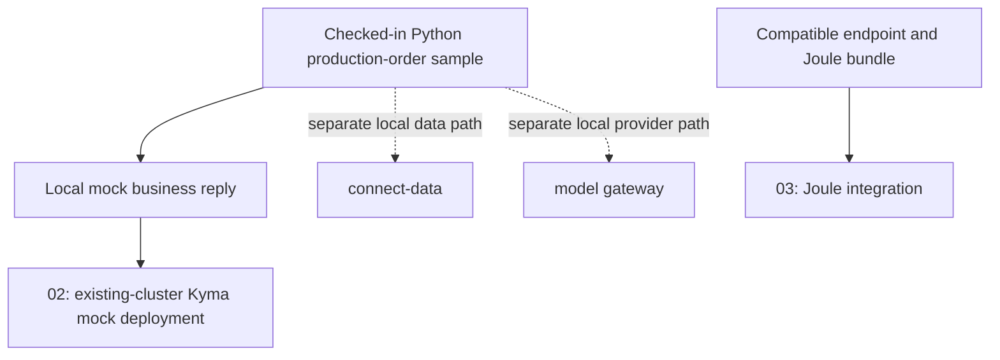

# Recipes

The working sample track uses the checked-in Python production-order agent.
Checkpoint 2 deploys its mock agent and private MCP service to an existing Kyma cluster.
The sample uses in-memory task state.
Live deployment and cleanup require their own evidence.

The older generated-project and optional guides describe separate follow-on paths.
They do not add HANA, a model provider, instrumentation, GitOps, or Joule compatibility to the mock deployment automatically.
Read each recipe's input and evidence limits before choosing that path.

## Layout

```
recipes/
  01-scaffold-agent/  checkpoint 1: local business agent and real message proof
  02-deploy-btp/      checkpoint 2: mock Python sample on an existing Kyma cluster
  03-joule/           checkpoint 3: a separate Joule-compatible integration path
  optional/           pull in only when the situation calls for it (incl. connect-data, RAG, KG, observability)
```

## The flow

Follow the local sample path, then the existing-cluster deployment recipe.
Use only public dependencies and the documented smoke command.
The optional recipes require separate integration and deployment tests.

| Checkpoint | Result | Prerequisite |
|---|---|---|
| [01: Local agent](01-scaffold-agent/) | A local business reply with mock records | The checked-in Python sample |
| [02: Existing Kyma](02-deploy-btp/) | A deployed mock agent that calls its private MCP service | An approved existing cluster and image registry |
| [03: Joule](03-joule/) | A reply inside Joule after separate integration | A Joule-compatible endpoint, tenant, authentication, and capability bundle |



The chart in checkpoint 2 fixes both providers to `mock`.
It does not consume generated CAP projects or the augmented projects from the optional guides.
Data, provider, HANA, logging, and GitOps paths need their own tested packaging.
A cluster-local URL alone does not meet Joule's endpoint requirements.

## Optional — pull in when needed

| Recipe | When | Relationship |
|---|---|---|
| [connect-data](optional/connect-data/) | A local agent needs backend records | The local data path needs separate deployment configuration. Checkpoint 2 stays mock-only. |
| [region-preflight](optional/region-preflight/) | A BTP service or model choice depends on regional availability | Provides regional context. Checkpoint 2 uses an existing cluster without model services. |
| [sovereign-model-gateway](optional/sovereign-model-gateway/) | An organization approves an OpenAI-compatible gateway | The provider path needs separate deployment configuration. Checkpoint 2 stays mock-only. |
| [bring-your-own-model](optional/bring-your-own-model/) | A team hosts a custom model in AI Core | Requires separate serving, consuming, and deployment evidence. |
| [gitops-cicd](optional/gitops-cicd/) | A team wants Argo CD delivery | Requires a tested application chart and pipeline integration. The mock chart is not integrated automatically. |
| [hana-vector-store](optional/hana-vector-store/) | An agent needs document retrieval | Requires HANA integration and separately tested application packaging. |
| [hana-kg-triple-store](optional/hana-kg-triple-store/) | An agent needs graph queries | Requires HANA integration and separately tested application packaging. |
| [observe-and-eval](optional/observe-and-eval/) | An agent needs observability and evaluation | Instrumentation and the evaluation harness remain separate work. |
| [sap-cloud-logging](optional/sap-cloud-logging/) | A workload needs Cloud Logging | Requires application instrumentation, service bindings, and telemetry pipelines beyond the mock chart. |

## Adding a recipe

1. Mirror the frontmatter of [`02-deploy-btp/README.md`](02-deploy-btp/README.md) at the top of the new recipe's `README.md`.
2. Numbered checkpoint recipes are reserved for the linear track; new material goes to `optional/` (opt-in) with a descriptive slug.
3. Open with the `> **Guided:** / **Flow:** / **Input:** / **Output:** / **Toolkit command:**` callout — the Guided line names the checkpoint it serves plus a paste-able mid-flow prompt, and the Input must literally name the producing step's Output.
4. Include `## Verify it works` — with a chat proof (a real message and the expected reply), not just the agent-card curl, wherever the recipe produces a runnable agent.
5. PR with the CONTRIBUTING checklist.
