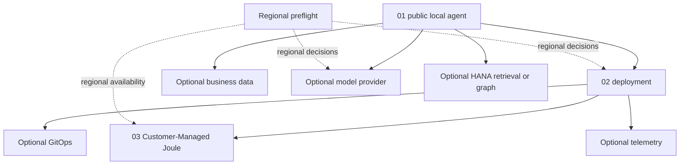

# Recipes

Start with the [local production-order agent](01-scaffold-agent/). The public
Python starter answers through A2A and two MCP tools with mock data. It needs
no BTP account, model endpoint, or credentials.

A recipe describes one capability and its prerequisites. A copied README does
not prove that its complete path works. Read the scope and evidence before
selecting an optional path.

## Checkpoints

| Checkpoint | Output | Current path |
| --- | --- | --- |
| [01 · Local agent](01-scaffold-agent/) | A business reply through A2A and MCP | Checked-in public starter with local terminal and container commands. |
| [02 · BTP deployment](02-deploy-btp/) | A deployed endpoint that answers | The minimal public sample includes a Kyma chart. The broader recipe still needs support assets and live proof. |
| [03 · Customer-Managed Joule](03-joule/) | A reply inside Joule | Separate tenant-level integration. Current instructions do not support SAP-Managed Joule. |

Use the [minimal A2A sample](../samples/fde-a2a-minimal/) for the protocol-only
path. Use the [production-order sample](../samples/production-order-agent/)
for the business-agent and MCP path. Neither path requires the internal
toolkit or a toolkit harness driver.

The diagram shows dependencies. It does not claim that all optional paths are
complete. HANA data paths can use synthetic data without a live S/4 connection.
Deployment to an existing cluster does not require BTP provisioning automation.

## Optional recipes

| Recipe | Capability | Current limitation |
| --- | --- | --- |
| [connect-data](optional/connect-data/) | Connect business records | The recipe describes sales orders. The public production-order sample already provides its own sandbox tools. |
| [region-preflight](optional/region-preflight/) | Discover regional services | Requery availability before a regional deployment. |
| [sovereign-model-gateway](optional/sovereign-model-gateway/) | Use an approved model endpoint | The recipe still assumes scaffolder and driver support beyond the public local starter. |
| [bring-your-own-model](optional/bring-your-own-model/) | Serve a custom model through AI Core | Serving and consuming paths need end-to-end proof. |
| [hana-vector-store](optional/hana-vector-store/) | Retrieve document context | Existing scoped evidence does not prove the complete public tool integration. |
| [hana-kg-triple-store](optional/hana-kg-triple-store/) | Query graph relationships | HANA loading, tool integration, and deployment need a complete public path. |
| [sap-cloud-logging](optional/sap-cloud-logging/) | Export logs, traces, and metrics | The public business agent needs instrumentation and deployment support. |
| [gitops-cicd](optional/gitops-cicd/) | Deploy through Argo CD | Referenced support assets and a working rollout remain incomplete. |
| [observe-and-eval](optional/observe-and-eval/) | Evaluate agent behavior | The portable evaluation harness is a placeholder. |

## Prepare local architecture choices

The [guided setup skill](../skills/sap-setup-btp-agent/) writes a
credential-free pilot manifest. The [coordinator](../docs/cookbookctl.md)
validates and renders that manifest. It does not generate or deploy the
business starter. The mock recipe does not need a pilot manifest.

## Add or adapt a recipe

Include prerequisites, exact commands, and the expected user-visible result.
State the tested scope and all required public dependencies. Use the
[contribution guide](../CONTRIBUTING.md) before submitting a change.

Include troubleshooting and cleanup. If the recipe runs an agent, send a real
message and inspect the reply. Keep credentials, private URLs, and customer
information outside public examples and evidence.
